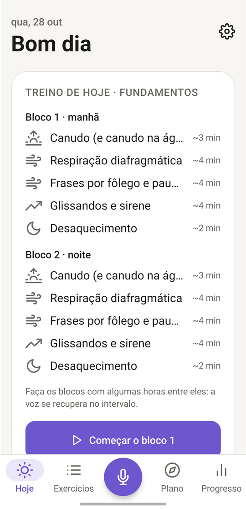
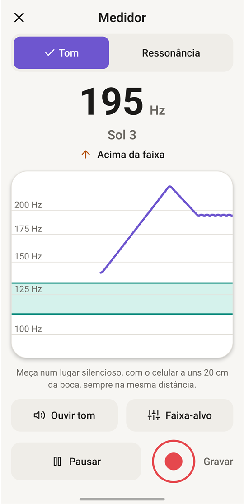
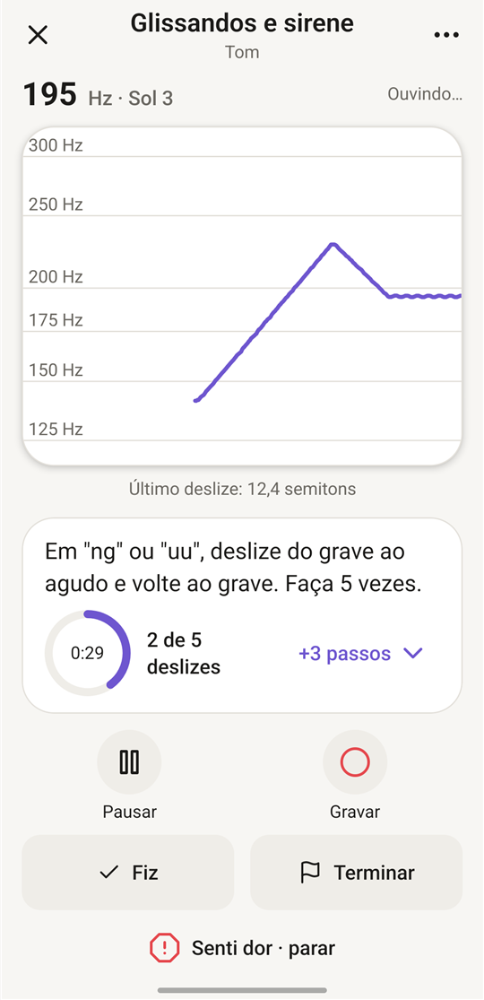
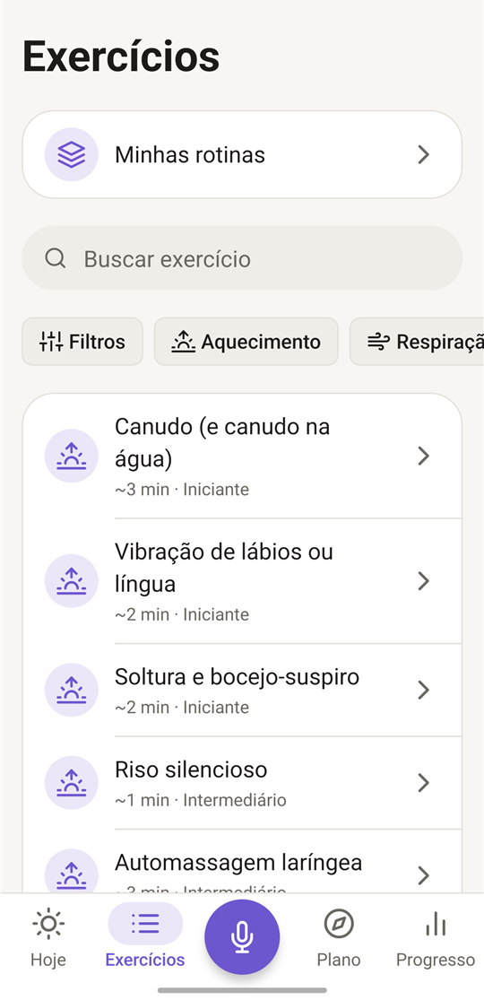
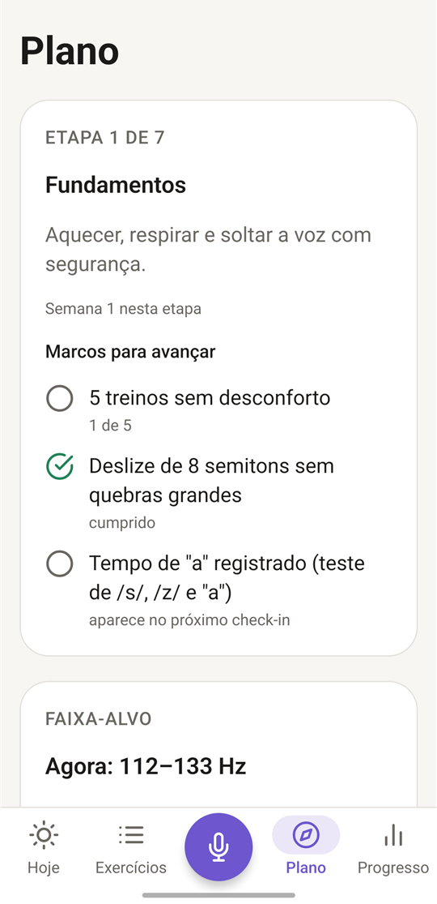
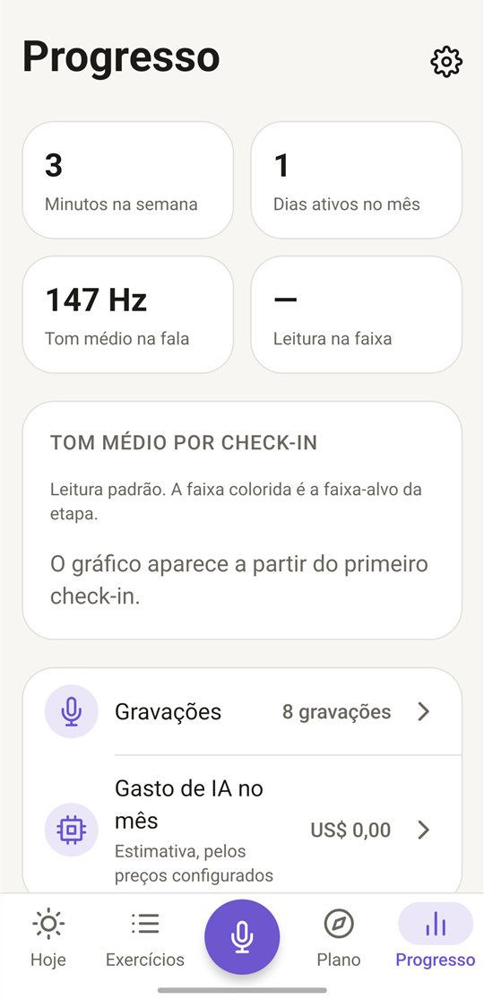

# MVoz

App Android para treinar a voz um pouco todo dia, com um plano que acompanha a sua evolução.
Feito para quem quer uma **voz mais feminina**, **mais masculina**, **mais neutra** ou simplesmente **cuidar da voz**.

Tudo fica no celular: sem login, sem servidor e **o áudio nunca sai do aparelho**.

<p align="center">
  
  
  
</p>
<p align="center">
  
  
  
</p>

## Por que eu criei o MVoz

Eu sou uma mulher trans e precisava de um jeito de treinar a minha voz **todos os dias**, com o objetivo de feminilizá-la.

A voz é uma fonte de disforia para a grande maioria das mulheres trans: ela pode não combinar com quem a gente é, e às vezes nos expõe em situações do dia a dia, como numa ligação, num pedido no balcão ou numa conversa com alguém desconhecido. Uma saída é a cirurgia nas cordas vocais. Outra é o treino: com prática diária, é possível mudar o tom, a ressonância e o jeito de falar **sem precisar de cirurgia**.

Só que treinar sozinha é difícil. É difícil saber se você está fazendo certo, lembrar de treinar todo dia, acompanhar a evolução e não forçar a voz. Por isso fiz um app que ouve a minha voz enquanto eu treino, monta um plano que vai avançando comigo e cuida para que o treino seja seguro. Ele serve para qualquer pessoa que queira mudar ou cuidar da própria voz, mas nasceu dessa necessidade.

## No que ele ajuda

- **Mostra a sua voz ao vivo.** O Medidor mostra o tom (em Hz e na nota), o traçado do tom e uma estimativa da ressonância (mais escura ↔ mais clara). Dá para marcar uma faixa-alvo e ouvir a nota de referência.
- **Monta um plano para você.** Um Guia curto pergunta o seu objetivo, a sua experiência e o tempo que você tem por dia. Depois você faz uma gravação inicial e o app propõe um plano em etapas: fundamentos → ressonância → tom → peso da voz → entonação → uso no dia a dia → manutenção.
- **Guia os exercícios e conta sozinho.** São 45 exercícios (aquecimento, respiração, tom, ressonância, peso, entonação e fala). Enquanto você faz, o app ouve e conta as repetições: "uuu" de 5 s, deslizes do grave ao agudo, notas sustentadas, frases na faixa. Quando não dá para medir, um toque em "Fiz" resolve.
- **Treino do dia sob medida.** A tela Hoje monta o treino com aquecimento, a habilidade da etapa, um exercício de fala e o desaquecimento. Tem versões de 5 minutos e "pegue leve hoje".
- **Check-in semanal.** Toda semana você grava uma leitura curta e responde 3 perguntas. O app compara com o início e com a semana passada e sugere avançar de etapa, continuar ou fazer uma semana mais leve. A decisão é sempre sua.
- **Mostra a evolução.** Gráficos do tom médio por check-in e da ressonância, gravações com filtros e comparação **antes × depois**.
- **IA opcional.** Explica um exercício passo a passo, comenta uma gravação, ajusta o plano a um pedido ("quero treinar para falar ao telefone"), responde dúvidas e escreve textos novos para ler. A IA recebe **só textos e números**, nunca o áudio. Funciona com qualquer serviço compatível com a OpenAI (Gemini, OpenAI, OpenRouter, Groq, Ollama…), com a sua própria chave.
- **Saúde da voz em primeiro lugar.** Aquecimento obrigatório antes de tom e ressonância, limite diário de minutos, botão **"Senti dor · parar"** em todo exercício, alertas para procurar fono ou otorrino e treino mais leve depois de desconforto.
- **Lembretes discretos.** Treino do dia, check-in, "use a voz hoje", pausa para a voz e retorno gentil. Os textos não citam o seu objetivo.
- **Seus dados com você.** Backup em arquivo (exportar e importar) e "Apagar tudo".

> O MVoz ajuda a praticar, mas **não substitui fonoaudiólogo(a) ou otorrino** e não faz diagnóstico.

## Como instalar no Android

1. **Baixe o APK.** No celular, toque em **[baixar o MVoz.apk](https://github.com/AmyNunes/MVoz/releases/latest/download/MVoz.apk)** (cerca de 38 MB), ou abra a página de [Releases](https://github.com/AmyNunes/MVoz/releases/latest) e toque em `MVoz.apk`.
2. **Abra o arquivo.** Toque na notificação do download ou abra o app **Meus arquivos** → **Downloads** → `MVoz.apk`.
3. **Permita a instalação.** Na primeira vez, o Android avisa que o navegador (ou o "Meus arquivos") não pode instalar apps. Toque em **Configurações** → ligue **"Permitir desta fonte"** → volte.
4. **Instale.** Toque em **Instalar**. Se o Play Protect avisar que o app não foi verificado, toque em **Mais detalhes** → **Instalar mesmo assim**. Isso é normal para um app que não veio da Play Store.
5. **Abra o MVoz.** Na primeira vez:
   - permita o **microfone** quando abrir o Medidor ou um exercício (sem ele, o app não ouve a voz);
   - permita as **notificações**, se quiser os lembretes (Configurações › Notificações);
   - na tela **Hoje**, toque em **"Responder o Guia"** e faça a gravação inicial (uns 3 minutos, num lugar silencioso).
6. **(Opcional) IA:** em **Configurações › IA**, escolha o provedor, cole a sua chave e toque em **"Testar conexão"**. A chave fica guardada só no celular, com criptografia.

**Para atualizar:** baixe o APK novo e instale por cima. Os seus dados (plano, treinos e gravações) continuam.

**Requisitos:** Android com processador de 64 bits (arm64), que é o caso de praticamente todos os celulares atuais.

## Para quem quer mexer no código

Feito com **Expo SDK 58** (React Native 0.88) e **TypeScript**, com Expo Router, SQLite (`expo-sqlite`), `expo-audio` (microfone ao vivo) e `pitchy` (detecção do tom). A ressonância (formantes) é estimada por LPC no próprio app.

```bash
npm install
npx expo run:android      # instala a versão de desenvolvimento no celular (cabo USB)
npx expo start            # roda o app ligado ao computador
npm test                  # testes (Jest)
npx tsc --noEmit          # tipos
npx expo lint             # lint
```

Para gerar o APK no computador: `npx expo prebuild --platform android` (uma vez) e depois, na pasta `android`, `./gradlew assembleRelease`. O arquivo sai em `android/app/build/outputs/apk/release/app-release.apk`.

A especificação completa está em [`docs/SPEC.md`](docs/SPEC.md). O conteúdo dos exercícios está em [`docs/EXERCICIOS.md`](docs/EXERCICIOS.md), e as evidências e valores de referência em [`docs/PESQUISA.md`](docs/PESQUISA.md).
